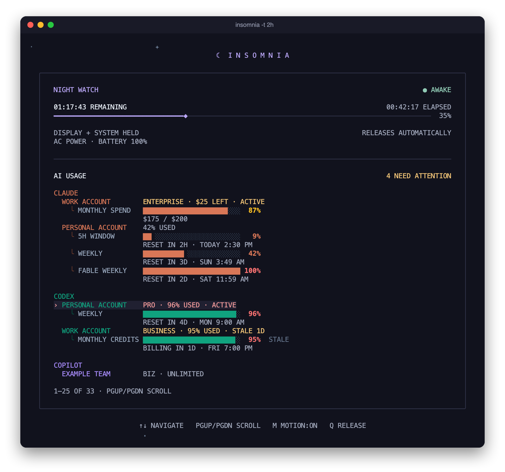
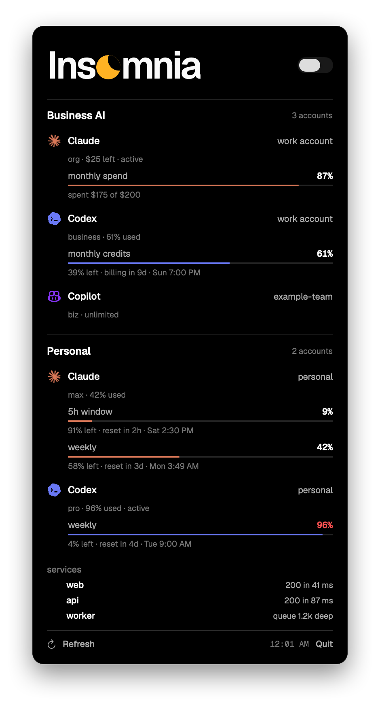

<h1 align="center">☾ insomnia</h1>

<p align="center">
  Keep your Mac awake, beautifully — a <code>caffeinate</code> replacement with a night-sky
  terminal dashboard and a menu bar app.
</p>

<p align="center">
  
</p>

insomnia holds IOKit power assertions directly — no sudo, no helper
`caffeinate` process — and the kernel lets go the instant it exits. While it
runs, a quiet starfield surrounds a session timer and a dashboard you can feed
with any shell command: Docker containers, AI quota, CI, whatever you watch.

- **Keep awake** — display, idle system, lid-closed (on AC), or disks; for a
  duration or until you quit.
- **Dashboard** — Docker is built in; anything else is a shell command that
  prints rows.
- **AI usage** — an optional card for Claude, Codex, and Copilot quota across
  all your accounts.
- **Menu bar app** — the same cards in a native popover, plus a
  keep-display-awake switch.

**macOS only.** insomnia talks to IOKit directly; that's the whole point.

## Install

Needs a Mac and [Rust](https://rustup.rs).

```sh
git clone https://github.com/cxkw-dev/insomnia && cd insomnia
make install   # builds `insomnia` into ~/.cargo/bin
make setup     # optional: starter config + the AI usage card
insomnia
```

`make setup` writes `~/.config/insomnia/config.toml`, the AI usage script,
and an empty account list. It never overwrites a file you already have. Skip
it and insomnia runs on defaults.

Quit with `q`, `esc`, or `ctrl-c`; the assertions release instantly. To pick
up code changes later, run `make install` again — the `insomnia` on your PATH
is a copy, not the working tree.

### Menu bar app



A native SwiftUI popover that reads the same config and cards through a
bundled Rust helper. AI accounts are grouped into **Business AI** and
**Personal** ([you choose which](#grouping-accounts)), each provider in its
brand color with reset times under every meter. Other cards show below. It
refreshes every 30 seconds.

The switch beside the wordmark keeps the display awake; the crescent turns
amber while it's on. Quitting the app, or turning the switch off, releases it.

Needs the Command Line Tools (`xcode-select --install`):

```sh
make install-app     # build, copy to /Applications, start at login
make uninstall-app   # remove it and its login item
```

Like the CLI, the installed app is a copy: rerun `make install-app` after
pulling changes.

<br clear="right">

## Usage

```sh
insomnia            # display + system stay awake (same as -d -i)
insomnia -d         # just the display
insomnia -t 2h      # two hours, then let go
insomnia -di -t 90m # flags combine; -t takes the last spot in a group
insomnia -q -t 1h   # no TUI, just hold quietly in the foreground
```

| flag | effect |
|------|--------|
| `-d` | keep the display awake |
| `-i` | keep the system awake while idle |
| `-s` | prevent sleep entirely, even lid-closed (AC power only) |
| `-m` | keep disks from idle-sleeping |
| `-t <time>`, `--for <time>` | stay awake for a duration, then release |
| `-q`, `--quiet` | skip the UI, hold quietly |
| `--config <path>` | config file (default `~/.config/insomnia/config.toml`) |
| `-h`, `--help` / `-V`, `--version` | help / version |

Durations read the way you'd say them: `300` (seconds, like `caffeinate -t`),
`90s`, `45m`, `2h`, `1h30m`.

| key | action |
|-----|--------|
| `↑` `↓` / `k` `j` | select a row |
| `page up` / `page down` | scroll the dashboard |
| `m` | pause or resume the sky's motion |
| `q`, `esc`, `ctrl-c` | release and quit |

## Dashboard

The session timer stays pinned at the top; the dashboard scrolls beneath it.
Small terminals wrap details and scroll, and a truly tiny one falls back to a
compact view.

### Docker

Built in, and on whenever the Docker daemon answers. Every container is
listed — running, paused, restarting, stopped — with uptime, health checks, and
exit details. Failures and unhealthy containers are flagged; clean stops stay
quiet. To turn it off:

```toml
[docker]
enabled = false
```

### Custom cards

A card is a shell command on a timer. Each line it prints becomes a row:

```toml
[[card]]
title = "services"
interval = 30
command = '''
for url in localhost:3000 localhost:8080; do
  if curl -sf -o /dev/null "$url"; then echo "ok|$url"; else echo "bad|$url|no answer"; fi
done
'''
```

| field | default | meaning |
|-------|---------|---------|
| `title` | required | the section's name |
| `command` | required | run with `sh -c` every `interval` seconds |
| `interval` | `10` | seconds between runs (minimum 2) |
| `glyph`, `accent`, `side` | — | only used with `[dashboard] combined = false` (below) |

Rows use a tiny pipe-separated protocol. Anything else prints as plain text.

| line | renders as |
|------|------------|
| `ok\|name\|detail` | a healthy item (`warn`, `bad`, and `off` for the other states; detail optional) |
| `hdr\|accent\|text` | a section header, e.g. a provider or environment |
| `bar\|accent\|label\|percent\|detail` | a 0–100 meter, attached to the row above it |

Accents: `violet` `pink` `sky` `blue` `emerald` `gold` `red` `slate` `coral`
`teal`. A card shows at most 32 rows, and only once its command succeeds with
output.

Card commands are your own code running as you. Keep tokens out of the TOML;
prefer authenticated CLIs (`gh`, `docker`), the Keychain, or your environment.

More to steal:

```toml
[[card]]
title = "pull requests"
interval = 120
command = 'gh search prs --state=open --review-requested=@me --json title --jq ".[].title"'

[[card]]
title = "todos"
command = 'curl -sf localhost:3000/api/todos | jq -r ".[].title"'
```

Prefer separate boxes beside the session instead of one frame? Set
`[dashboard] combined = false`; each card then uses its `glyph`, `accent`, and
`side` (`left` or `right`).

## AI usage

[`cards/ai-usage.sh`](cards/ai-usage.sh) is an optional card showing quota
windows, reset times, spend, and an hourly trend:

| service | accounts come from | needs |
|---------|--------------------|-------|
| Claude | Claude Code's login and Claude Desktop's active session | `jq`, `curl` |
| Codex | `~/.codex/auth.json`, shared by the Codex CLI and app | `jq`, `curl` |
| Copilot | every account in `gh auth status` | `jq`, `curl`, [`gh`](https://cli.github.com) |

`make setup` installs it as `~/.config/insomnia/ai-usage.sh` and adds the
card. Services you aren't logged into are skipped. To preview what it will
show, run `~/.config/insomnia/ai-usage.sh all`.

### Adding accounts

Whatever you're logged into right now appears on its own, marked `▸`.

- **Copilot** — `gh auth login` each GitHub account; all of them appear.
- **Another Claude or Codex account** — log into it (`/login` in Claude Code,
  or `codex login`), save it under a name, then log back into your usual one:

  ```sh
  ~/.config/insomnia/ai-usage.sh capture claude work
  ~/.config/insomnia/ai-usage.sh capture codex work
  ```

- **Always list an account**, even while it's logged out, in
  `~/.config/insomnia/ai-usage/accounts.conf`. It shows as `not logged in`
  until a login or capture with that name exists:

  ```text
  claude work
  codex personal
  copilot my-github-handle
  ```

Login tokens rotate. A captured account keeps refreshing while it's logged
in somewhere the card can see; once it's logged out everywhere it eventually
goes `stale`, and the row says so rather than showing old numbers as current.
Capture it again to revive it.

### Grouping accounts

The menu bar app files accounts under **Business AI** or **Personal** by plan:
org, business, enterprise, and team plans are business, the rest personal.
Override that by naming accounts — any case-insensitive part of the name the
card prints:

```toml
[accounts]
personal = ["jane", "side-project"]
business = ["acme"]
```

### Privacy

Everything stays on your Mac, in `~/.config/insomnia/ai-usage/` (mode 700):
captured logins, a short response cache, and trend samples. The script talks
only to each provider's own usage endpoint — the same undocumented ones their
apps use, so they can change without notice. Reading Claude Desktop's session
may prompt once for Keychain access to "Claude Safe Storage".

## Configuration

Everything is optional; no file is needed. The annotated starting point is
[`cards/config.example.toml`](cards/config.example.toml).

```toml
# ~/.config/insomnia/config.toml (or $XDG_CONFIG_HOME/insomnia/config.toml)

[docker]
enabled = true          # false hides containers

[sky]
motion = true           # false starts with a still sky (`m` toggles)
comets = true           # flyers: comets, shooting_stars
shooting_stars = true

[dashboard]
combined = true         # one frame; false for separate boxes

[accounts]              # menu bar grouping for AI accounts
personal = ["jane"]

[[card]]                # as many as you like
title = "ai usage"
interval = 30
command = '"$HOME/.config/insomnia/ai-usage.sh" all'
```

A misspelled section, flyer, or accent is an error that lists the valid names.

## The sky

Sparse stars, three comets on long orbits, and the occasional shooting star
drift around the edges; the dashboard itself stays still. Everything moves
from a tick counter and a position hash — no state — so any frame can be
rendered headlessly, which is how the screenshot above is made.

Adding a flyer takes a draw function and one entry in `sky::FLYERS`; its
`[sky]` toggle appears automatically. The guide is at the top of
[`terminal/src/sky.rs`](terminal/src/sky.rs). Pull requests welcome — the sky
has room.

## How it works

insomnia calls `IOPMAssertionCreateWithName`, the API `caffeinate` uses, to
hold assertions like `PreventUserIdleDisplaySleep` from its own process. The
kernel ties assertions to the process, so they release the moment insomnia
exits — even on `SIGKILL`. Check while it runs:

```sh
pmset -g assertions | grep insomnia
```

Slow work — `pmset`, `docker`, card commands — runs on background threads, one
per source, streaming to the renderer. A hanging command only delays its own
rows; the animation never stutters.

## Development

```sh
make run           # run from the working tree
make check         # fmt + clippy + tests, before committing
make preview       # one headless text frame
make screenshots   # regenerate docs/*.png from fixture data (needs Chrome)
```

The Rust crate is in [`terminal/`](terminal/), the menu bar app in
[`macos/`](macos/), and the optional cards in [`cards/`](cards/). Screenshots
use only the fixtures in [`docs/fixtures/`](docs/fixtures/), never live
accounts.

## License

[MIT](LICENSE)
